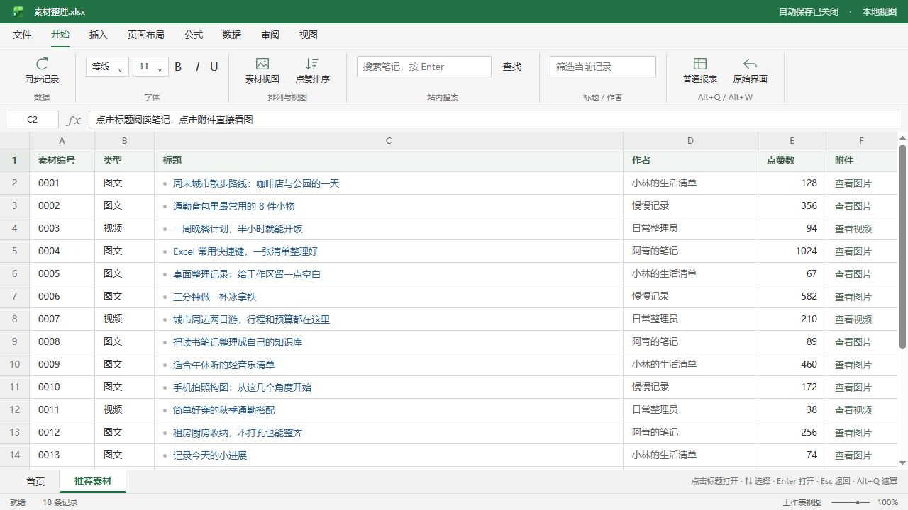
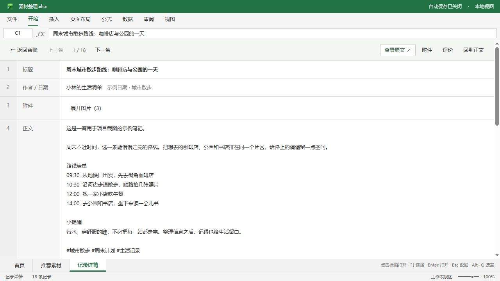
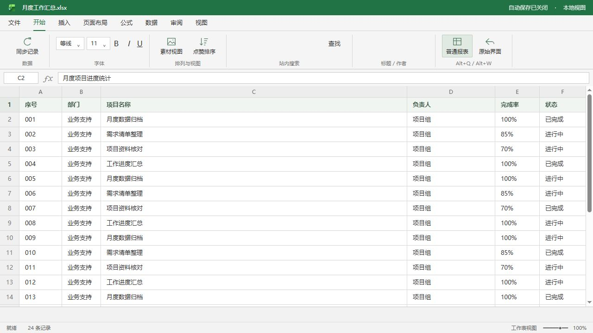

# 小红书摸鱼助手

**把小红书网页版变成 Excel / WPS 风格工作簿，直接浏览图文、视频和评论。**

### [点击跳转安装脚本](https://update.greasyfork.org/scripts/603375/xiaohongshu-excel.user.js)

安装地址：<https://update.greasyfork.org/scripts/603375/xiaohongshu-excel.user.js>

先安装 Tampermonkey，再点击上面的文字或链接；弹出 Tampermonkey 安装页面后，点击「安装」。完整步骤见下方「安装」。

[](LICENSE)
[](https://github.com/TheWebDog/xiaohongshu-excel/stargazers)

[Greasy Fork 介绍页](https://greasyfork.org/zh-CN/scripts/603375) · [反馈问题](https://github.com/TheWebDog/xiaohongshu-excel/issues) · [更新记录](CHANGELOG.md)

## 效果预览

下图使用脚本真实渲染界面和示例内容，便于展示功能，不包含真实账号或登录二维码。



<details>
<summary>查看笔记阅读和普通报表遮罩</summary>





</details>

## 安装（电脑浏览器）

1. **安装 Tampermonkey（篡改猴）扩展**：打开 <https://www.tampermonkey.net/>，选择你的浏览器，按提示添加扩展。
2. **[点击跳转安装脚本](https://update.greasyfork.org/scripts/603375/xiaohongshu-excel.user.js)**：也可以直接打开安装地址 <https://update.greasyfork.org/scripts/603375/xiaohongshu-excel.user.js>。
3. **在弹出的 Tampermonkey 页面点击「安装」**，完成脚本安装。
4. **打开或刷新小红书网页版**：<https://www.xiaohongshu.com/explore>，页面会切换成表格界面。

觉得有用，欢迎点击本页右上角的 **⭐ Star** 支持这个项目。

已安装的用户可在脚本管理器中检查更新。Greasy Fork 是推荐安装和更新渠道；本仓库用于维护源码、记录问题和协作。

## 功能

| 场景 | 操作与效果 |
| --- | --- |
| 推荐与搜索 | 表格显示标题、作者、点赞和附件，支持当前记录筛选、点赞排序、缩略图 |
| 阅读笔记 | 单击标题打开；返回列表保留筛选、选中项和滚动位置；详情顶部可查看原文 |
| 图片 | 翻页、适应窗口、放大阅读；下载当前图片或全部图片 ZIP |
| 视频 | 工作簿内播放，支持暂停、进度、音量、静音、倍速和 MP4 下载 |
| 评论 | 在评论末尾继续读取，展开回复，追加时保留阅读位置 |
| 登录 | 显示未登录状态；需要登录时保留小红书原生扫码／手机号弹窗 |
| 遮罩 | Alt+Q 切换普通报表，同时暂停和静音媒体，恢复后需手动继续播放 |
| 图标 | 使用 Excel 官网原版产品图标；切回原始界面时恢复原站图标 |

## 快捷键

| 快捷键 | 功能 |
| --- | --- |
| Alt+Q | 开启／关闭普通报表遮罩 |
| Alt+W | 工作簿／原始界面切换 |
| Esc | 返回列表；原生登录弹窗打开时遵循原站键盘交互 |
| ↑ / ↓、Enter | 列表选择、打开笔记 |
| ← / → | 图片翻页；视频展开时前后跳转 5 秒 |
| 空格 | 视频播放／暂停 |

## 使用说明

- 已验证环境为桌面 Chromium 浏览器与 Tampermonkey；其他浏览器和管理器欢迎反馈兼容性。
- 登录、内容访问权限和站内限制仍由小红书决定，脚本保留原生登录过程。
- 视频默认暂停。切换笔记、收起附件、返回列表、开启遮罩或页面进入后台时停止播放。
- 遮罩作用于当前网页内容，网页地址保持不变。
- 小红书页面结构变化可能影响适配。资源下载取决于原站提供的地址和浏览器请求结果。

## 权限与隐私

脚本只匹配 `https://www.xiaohongshu.com/*`，使用 `@grant none`，不申请额外 GM 扩展特权。脚本不新增统计、内容上传或外部下载中转服务；图文、视频和评论由原站加载，下载在浏览器中处理。登录使用原站组件，脚本不接管账号、密码或验证码。

## 开发与发布

直接维护 [xhs-workbook.user.js](xhs-workbook.user.js)，语法检查：

```sh
node --check xhs-workbook.user.js
```

main 分支保持可安装版本。修改功能或元数据时递增 `@version` 并更新 [CHANGELOG.md](CHANGELOG.md)。Greasy Fork 的代码从 main 的原始脚本地址同步，说明来自 docs/greasyfork.md。GitHub 推送通过 Webhook 通知更新，可在 Greasy Fork 管理页查看同步状态。

提交问题请提供浏览器与管理器版本、复现步骤、预期／实际结果，截图中隐去个人信息。贡献方式见 [CONTRIBUTING.md](CONTRIBUTING.md)。觉得好用欢迎 Star。

## 许可证与第三方素材

本项目自行编写的代码采用 [MIT License](LICENSE)。Excel 产品图标及相关商标归微软所有，不包含在本项目代码的 MIT 授权范围内；来源和权利说明见 [THIRD_PARTY_NOTICES.md](THIRD_PARTY_NOTICES.md)。本项目与小红书、微软没有隶属或背书关系。
