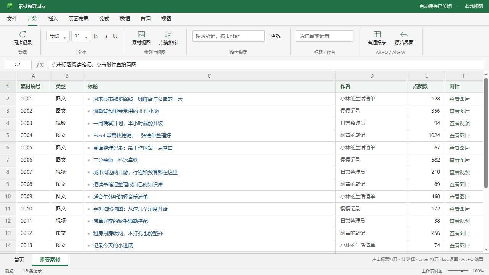

# 小红书摸鱼助手

把小红书网页版整理成 Excel / WPS 风格工作簿，直接浏览图文、视频和评论。

**[GitHub 源码与 Star](https://github.com/TheWebDog/xiaohongshu-excel) · [问题反馈](https://github.com/TheWebDog/xiaohongshu-excel/issues) · [更新记录](https://github.com/TheWebDog/xiaohongshu-excel/blob/main/CHANGELOG.md)**

安装请使用本页的「安装此脚本」按钮。已安装的用户可在脚本管理器中检查更新。

截图使用真实脚本渲染和示例内容，不包含真实账号与登录二维码。

## 功能

- 推荐和搜索结果以表格显示，支持筛选、点赞排序、缩略图和阅读位置保留。
- 在工作簿中看图片、播放视频、读取评论及展开回复。
- 下载当前图片、全部图片 ZIP 或视频 MP4，支持进度和取消。
- 详情顶部可打开同一篇笔记的原始页面。
- 未登录时显示提示和登录入口，保留原站扫码／手机号登录弹窗。
- Alt+Q 切换普通报表，同时暂停并静音媒体；恢复后需手动继续。
- 使用 Excel 官网的原版产品图标，原始界面模式恢复原站图标。

## 快捷键

| 快捷键 | 操作 |
| --- | --- |
| Alt+Q | 普通报表遮罩 |
| Alt+W | 工作簿／原始界面 |
| Esc | 返回列表；登录弹窗遵循原站交互 |
| ↑ / ↓、Enter | 选择和打开记录 |
| ← / → | 图片翻页／视频前后跳转 5 秒 |
| 空格 | 播放／暂停视频 |

## 兼容与权限

已验证桌面 Chromium 浏览器与 Tampermonkey。小红书结构变化可能影响适配；登录和内容访问权限仍由原站决定。遮罩作用于网页内容，地址不变。

脚本只匹配 `https://www.xiaohongshu.com/*`，使用 `@grant none`，不申请额外 GM 扩展特权。不新增统计、内容上传或外部下载中转服务，登录使用原站组件。

## 开源和素材

原创代码采用 MIT，完整源码、文档和协作位于 GitHub。Excel 图标及相关商标归微软所有，来源和独立权利说明见 [THIRD_PARTY_NOTICES](https://github.com/TheWebDog/xiaohongshu-excel/blob/main/THIRD_PARTY_NOTICES.md)。本项目与小红书、微软没有隶属或背书关系。

版本和说明从 GitHub main 分支自动同步，安装入口保持本条目不变。
